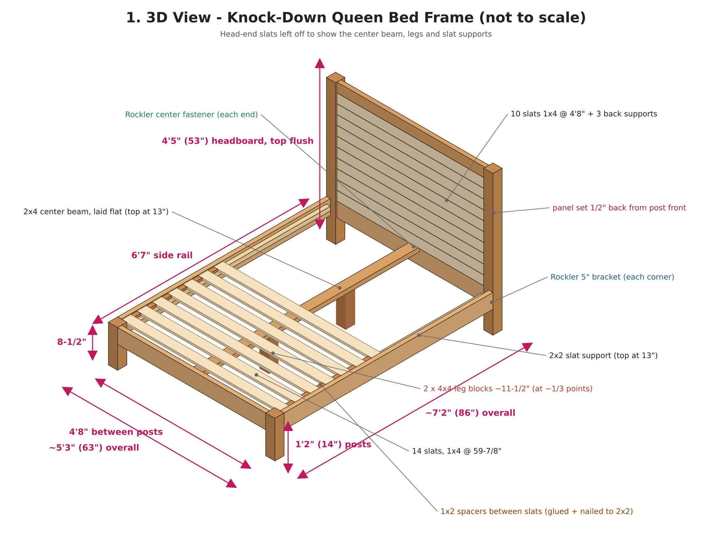
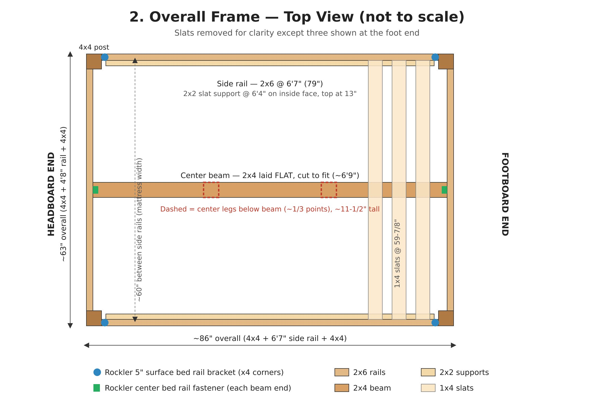
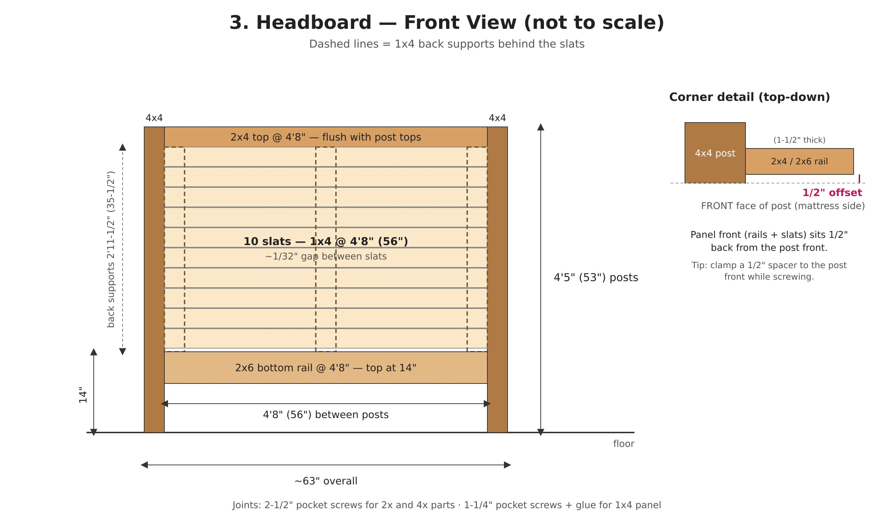
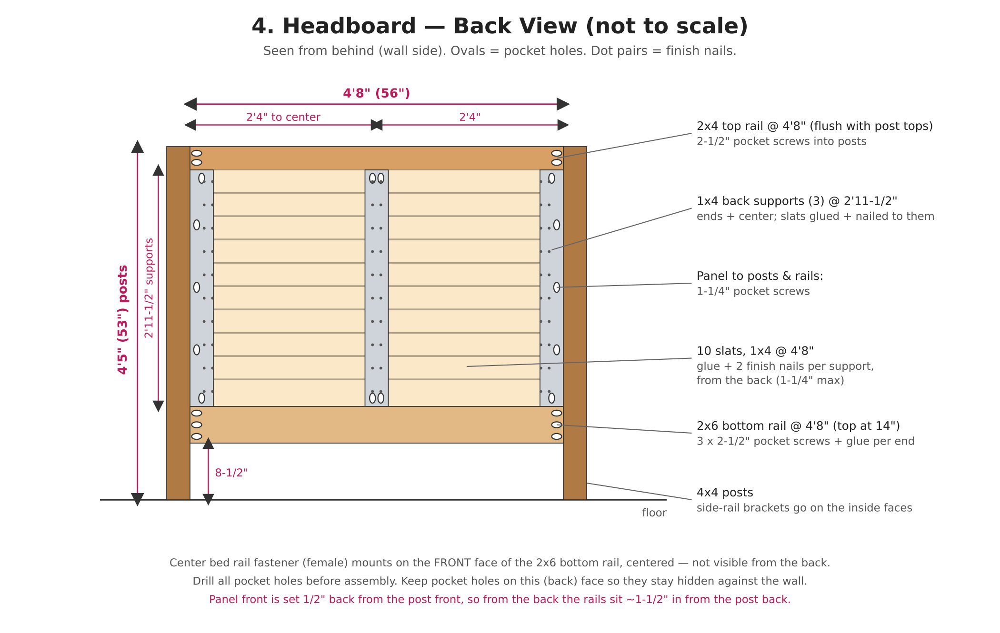
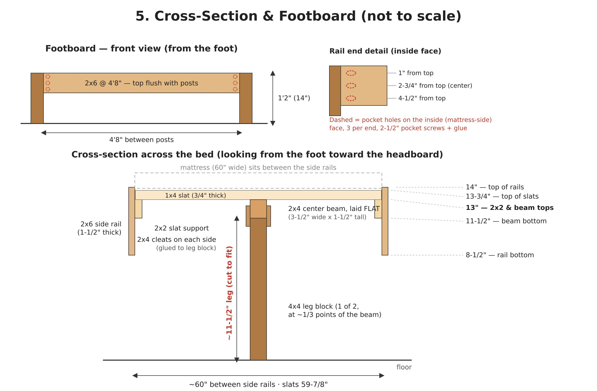
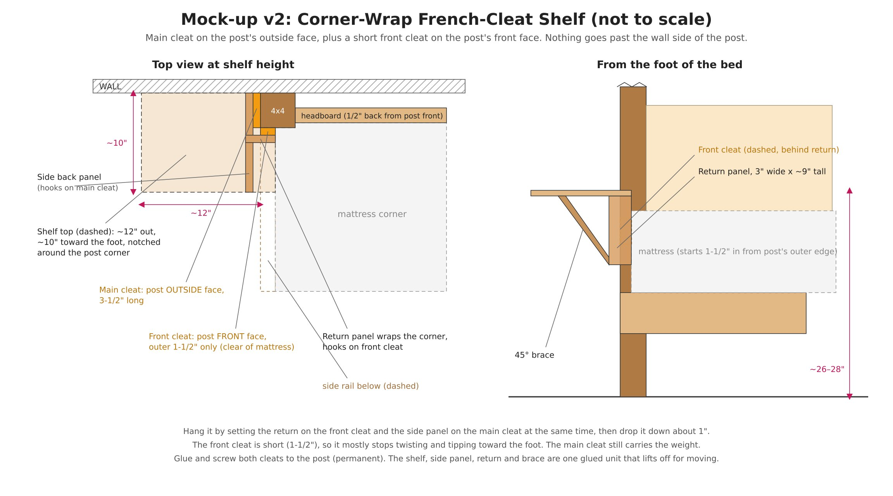
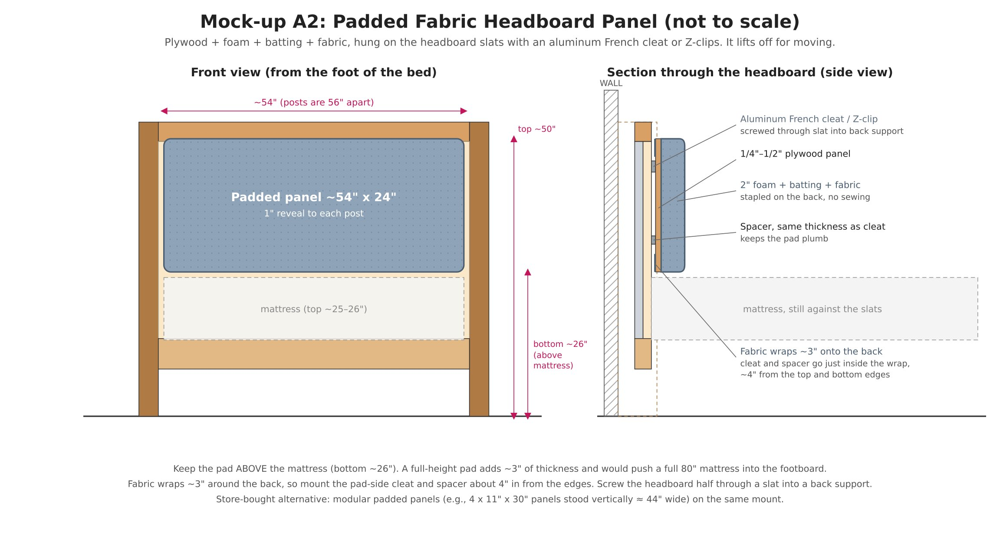

# DIY Queen Bed Frame & Wood Headboard — Build Guide

**Based on:** [A Piece of Rainbow – DIY Bed Frame & Headboard](https://www.apieceofrainbow.com/diy-bed-frame-headboard/)
**Size:** Queen (60" x 80" mattress)
**Changes from the original plan:**
- **One 2x4 center beam**, laid flat, replaces the two 2x4 stringers.
- **Rockler center bed rail fasteners** connect the beam to the headboard and footboard rails.
- **Two 4x4 leg blocks** at about the 1/3 points hold up the center beam. They're cut from leftover 4x4, so they cost nothing extra.
- **Rockler 5" surface-mounted brackets** attach the side rails.
- **Side rails 6'7"** (1" longer than the original plan) for extra mattress room at the corners, making the frame **~86" long overall**.
- **1x4 board slats** and **1x2 spacers** replace the plywood. Only straight crosscuts are needed, so there's no table saw or ripping.

**Box spring:** Not needed.

---

## Diagrams (not to scale)

1. **3D view**: the whole frame, labeled ([Section 4](#4-build-steps))
2. **Overall top view**: layout and hardware locations (Steps 2, 5 and 7)
3. **Headboard front view**: with the 1/2" offset corner detail (Step 3)
4. **Headboard back view**: back supports and pocket holes (Step 3)
5. **Cross-section and footboard**: all heights (Steps 4 and 6–9)

---

## 1. Supply List & Pricing

Prices were checked on **Nov 15, 2026** at **Lowe's S. Bel Air** and **Home Depot Edgewood** (GRK screws). Rockler is used for the bed hardware. Tools and sandpaper are not included (already on hand).

### Lumber — Lowe's

| Qty | Item | Each | Total |
|---:|---|---:|---:|
| 2 | 4-in x 4-in x 8-ft #2 Premium Douglas Fir (green, untreated) | $13.12 | $26.24 |
| 2 | 2-in x 6-in x 12-ft #2 Fir Kiln-Dried | $15.13 | $30.26 |
| 2 | 2-in x 4-in x 96-in Kiln-Dried #2 Premium *(headboard top + center beam)* | $4.75 | $9.50 |
| 13 | RELIABILT 1-in x 4-in x 10-ft #2 & Better Whitewood Board *(13 boards, 2 cuts each: 5 boards → 10 headboard slats, 1 board → 3 back supports, 7 boards → 14 bed slats)* | $12.84 | $166.92 |
| 1 | RELIABILT 1-in x 2-in x 8-ft Clear S4S Radiata Pine *(slat spacers, same 1-1/2" width as the 2x2; Aisle 49, Bay 5)* | $7.98 | $7.98 |
| 2 | 2-in x 2-in x 8-ft Whitewood Furring Strip (Item #4513) | $2.98 | $5.96 |
| | | **Lumber subtotal** | **$246.86** |

### Pocket Screws, Glue & Finish — Lowe's

| Qty | Item | Each | Total |
|---:|---|---:|---:|
| 1 | Kreg #8 x 2-1/2-in Zinc Pocket Hole Screws (50 ct) | $8.98 | $8.98 |
| 1 | Kreg #8 x 1-1/4-in Zinc Pocket Hole Screws (100 ct) | $9.98 | $9.98 |
| 1 | Titebond II Premium Wood Glue (16 oz) | $8.98 | $8.98 |
| 1 | Minwax Wipe-On Poly, Clear (1 pint) *(or your finish of choice)* | $22.98 | $22.98 |
| 3 | Scotch Easy Cut 1/2-in x 60-in Brown Felt Roll *(anti-squeak pads under the slats)* | $5.98 | $17.94 |
| | | **Lowe's hardware subtotal** | **$68.86** |

### Wood Screws — Home Depot (GRK)

| Qty | Item | Each | Total |
|---:|---|---:|---:|
| 1 | GRK R4 #8 x 1-1/4-in Star Drive Bugle Head Multi-Purpose (110 pk, Model 96080) *(bed rail brackets, and 1 per bed slat end into the 2x2s)* | $14.98 | $14.98 |
| 1 | GRK Cabinet #10 x 2-1/2-in Star Drive Low Profile Washer Head (50 pk, Model 96070) *(2x2 slat supports to side rails)* | $11.31 | $11.31 |
| | | **Home Depot subtotal** | **$26.29** |

### Bed Hardware — Rockler

| Qty | Item | Each | Total |
|---:|---|---:|---:|
| 1 pk | 5" Surface Mounted Bed Rail Brackets (Item #30247): 4 matched sets, made for 6"-wide rails. **Screws not included (#8).** | $15.99 | $15.99 |
| 1 pr | Center Bed Rail Fasteners (Item #10025): 2 male + 2 female. **#5 x 5/8" screws included.** | $12.99 | $12.99 |
| | | **Rockler subtotal** | **$28.98** |

### Total

| | Amount |
|---|---:|
| Lowe's subtotal | $315.72 |
| Home Depot subtotal | $26.29 |
| Rockler subtotal | $28.98 |
| **Subtotal** | **$370.99** |
| MD sales tax (6%) | $22.26 |
| **Estimated total** | **~$393** |

Add Rockler shipping. Rockler shows free shipping on orders over $99 with code FREE99, and this order is under that.

**Notes**
- **Center legs:** a 2x4 laid flat is only 1-1/2" tall, so it needs support along its length. **Two 4x4 leg blocks at about the 1/3 points** give spans of about 26". They're cut from the leftover 4x4, at no extra cost.
- **5" bracket screws:** use the GRK #8 x 1-1/4" on both halves. Don't go longer on the rail side: a 1-1/2" screw through the bracket would nearly poke through the 1-1/2" rail.
- **Why the GRK Cabinet screw for the 2x2s:** its flat washer head clamps the 2x2 tight to the rail without countersinking, and 2-1/2" goes through the 2x2 (1-1/2") and 1" into the rail.
- **Pocket screws:** stay with Kreg (or another true pocket-hole screw). Regular GRK screws (bugle/trim heads) don't seat on the flat bottom of a pocket hole. They wedge in and can split the stock or pull through, so the joint won't clamp tight. Off-brand pocket screws work fine, but you need fewer than 30 of each size, so the two Kreg boxes ($18.96) are about as cheap as it gets.
- **Optional upgrade, clear headboard slats:** replace 5 of the #2 1x4x10s with **5 RELIABILT 1-in x 4-in x 12-ft Unfinished Clear S4S Radiata Pine** at $19.42 each (2 slats per board). That's $97.10 instead of $64.20, so **about +$33** (+$35 with tax). See "Wood grade" below.
- **Finish nailer (on hand):** nails plus glue replace screws on the headboard slats and the slat spacers, which saves time and screws. Keep screws or pocket screws everywhere that carries load or has end grain: rail-to-post joints, the panel to the posts and rails, the 2x2 slat supports (they carry the mattress), the brackets, and the slats to the 2x2s.
- **No pressure-treated lumber.**

### Wood grade

Big-box dimensional lumber is sold as **#2 / #2 & Better / #2 Prime / Premium**. True **#1 or Select Structural is rarely stocked**, and it isn't needed for strength: #2 is rated for house framing, which is far more load than a bed.

What actually changes how long this lasts and how it looks is **picking boards and choosing grade where it shows**:

| Part | Shows? | Recommendation |
|---|---|---|
| 4x4 posts, 2x6 rails, 2x4 top | Yes | #2 Premium / #2 & Better is fine. **Hand-pick** straight boards with tight grain, no splits, and no knots near the ends where screws and brackets go. |
| Headboard 1x4 slats (10) | **Most visible part** | #2 whitewood gives a knotty, rustic look (like the original). For a cleaner look, use **clear pine** (optional upgrade above). |
| Back supports, 2x2s, center beam, bed slats, spacers | No | #2 is fine. Just avoid twisted or cracked pieces. |

**Tips for a long-lasting, good-looking result:**
- Let the lumber sit indoors for **1–2 weeks** before cutting, especially the green Douglas fir 4x4s. They shrink and can check (split) as they dry, and they'll move less after they acclimate.
- Sight down every board in the store and reject any with crook, twist or cup.
- Seal all faces, including the backs and ends, so the wood takes on and loses moisture evenly.

---

## 2. Cut List

### What each board becomes

| Stock Board | Cuts | Leftover |
|---|---|---|
| 4x4x8 (#1) | 1 @ 4'5" (headboard post) + 1 @ 1'2" (footboard post) | ~2'5" → 2 center leg blocks |
| 4x4x8 (#2) | 1 @ 4'5" (headboard post) + 1 @ 1'2" (footboard post) | ~2'5" |
| 2x6x12 (#1) | 1 @ 6'7" (side rail) + 1 @ 4'8" (headboard bottom rail) | ~9" |
| 2x6x12 (#2) | 1 @ 6'7" (side rail) + 1 @ 4'8" (footboard rail) | ~9" |
| 2x4x96 (#1) | 1 @ 4'8" (headboard top) | ~3'4" |
| 2x4x96 (#2) | 1 **center beam — cut to fit** (~6'9"–6'11", minus fastener thickness) | ~1'+ |
| 1x4x10 (boards 1–5) | 2 @ 4'8" each → 10 headboard slats | ~8" each |
| 1x4x10 (board 6) | 3 @ 2'11-1/2" (headboard back supports) | ~1'1" |
| 2x2x8 (x2) | 1 @ 6'4" each (slat supports) | ~1'8" each |
| 1x4x10 (boards 7–13) | 2 @ 59-7/8" each → 14 bed slats | — |
| 1x2x8 | ~26 spacers, cut to the gap between slats (~2-5/16"; see Step 9) | ~3' |

### Finished part summary

| Part | Material | Qty | Length |
|---|---|---:|---|
| Headboard posts | 4x4 | 2 | 4'5" (53") — top flush with the 2x4 top rail |
| Footboard posts | 4x4 | 2 | 1'2" |
| Side rails | 2x6 | 2 | 6'7" (1" extra for mattress room) |
| Headboard & footboard rails | 2x6 | 2 | 4'8" |
| Center beam (laid flat) | 2x4 | 1 | cut to fit |
| Center leg blocks | 4x4 | 2 | ~11-1/2" (cut to fit) |
| Headboard top | 2x4 | 1 | 4'8" |
| Headboard slats | 1x4 | 10 | 4'8" |
| Headboard back supports | 1x4 | 3 | 2'11-1/2" |
| Slat supports | 2x2 | 2 | 6'4" |
| Bed slats | 1x4 | 14 | 59-7/8" |
| Slat spacers | 1x2 (3/4" x 1-1/2", same width as the 2x2) | ~26 | ~2-5/16" (cut to fit) |

> **Tip:** Cut the center beam and the leg blocks **last**, after the frame is assembled and the center fasteners are mounted.

---

## 3. Key Heights (with 14" footboard posts and 3/4"-thick 1x4 slats)

| Item | Height from floor |
|---|---|
| Top of side rails / footboard rail | 14" |
| Top of slats (1/4" below rail top) | 13-3/4" |
| Top of 2x2 slat supports **and** top of center beam | **13"** |
| Bottom of center beam (2x4 flat = 1-1/2" tall) | 11-1/2" |
| **Center leg block height** | **~11-1/2"** (measure and cut to fit) |

The flat 2x4 sits entirely within the face of the 2x6 end rails, which run from 8-1/2" to 14" off the floor, so the center fasteners have full wood behind them.

---

## 4. Build Steps

### Glue map: where to glue and where NOT to

Glue only joints that stay together for good. **Never glue a joint that has to come apart for moving**, or the bed won't knock down.

| Joint | Glue? | Why |
|---|:---:|---|
| Headboard slats → back supports | ✅ **Glue** + finish nails from the back | Permanent panel. The face-to-face glue does the work and the nails just clamp it while it dries |
| Headboard panel (back supports) → posts, 2x4 top, 2x6 rail | ✅ **Glue** + 1-1/4" pocket screws | Permanent headboard |
| Headboard 2x4 top and 2x6 bottom rail → posts | ✅ **Glue** + 2-1/2" pocket screws | Permanent headboard |
| Footboard 2x6 rail → posts | ✅ **Glue** + 2-1/2" pocket screws | Permanent footboard |
| 2x2 slat supports → side rails | ✅ **Glue** + screws | Stays on the rail when it's moved |
| Leg cleats → 4x4 leg blocks | ✅ **Glue** + screws | Becomes part of the leg |
| Slat spacers → 2x2s | ✅ **Glue** + 1 finish nail (after spacing is set) | The 2x2s stay on the rails, so the spacers never come off. Glue to bare wood, not felt |
| Rockler bed rail brackets (side rails ↔ posts) | ❌ **No glue** | Knock-down joint |
| Rockler center fasteners (beam ↔ end rails) | ❌ **No glue** | Knock-down joint |
| Center beam ↔ legs or leg cleats | ❌ **No glue** | Lifts out for moving |
| Bed slats → 2x2s | ❌ **No glue**, 1 screw per end | Screws stop shifting and squeaks; back them out for moving |
| Bed slats → center beam | ❌ **No glue, no screws** | The end screws hold the slats |
| Felt pads | ❌ No glue (self-adhesive) | Spacer glue won't bond to felt, so keep felt only where the slats land |
| Any metal hardware | ❌ **No glue** | Glue doesn't help metal-to-wood; use the screws |

**Tips:**
- Use Titebond II and wipe up any squeeze-out right away. Dried glue blocks stain and finish.
- On end grain (rail ends into posts), use the two-coat method from Step 3.
- If you finish before assembly, keep finish off the glue surfaces. Glue won't bond to a finished face.

### Step 1 — Prep the parts
1. Cut everything except the center beam and the leg blocks.
2. Line up matching pieces and confirm they're identical in length.
3. Sand cut edges and exposed faces with what you have on hand (roughly 120 grit, then 180–220 before finish).
4. Optional: apply finish now.

### Step 2 — Install the 5" surface-mounted brackets (4 sets)
1. Butt a side rail (2x6) against a post, with the top edges flush and the end touching the post.
2. Hold a bracket set in its locked position. Its 5" length centers on the 5-1/2" rail face. Mark its edges and screw holes.
3. Pre-drill, then screw the post half to the 4x4 and the rail half to the 2x6, using #8 screws. **No glue**, since this is the knock-down joint.
4. Repeat for all four corners, checking height and alignment each time. The set is made in left and right versions, so match each one to its corner.

### Step 3 — Build the headboard
1. Drill all pocket holes first.
2. Glue and nail the 10 slats (1x4 @ 4'8") to the 3 back supports (1x4 @ 2'11-1/2"). Spread glue on each support where it crosses a slat, then drive **2 finish nails per slat at each support from the back**, through the support into the slat. Use **1-1/4" nails at most**: support plus slat is only 1-1/2" thick, so anything longer can poke through the show face. Angle the nails slightly, and test one on scrap first. Put one support flush at each end and center the third (2'4" from each end), as shown in the back-view diagram. Leave about a 1/32" gap between slats.
3. Glue and attach the panel to the two 4'5" posts. **Set the whole panel (2x4 top, slats, 2x6 bottom rail) 1/2" back from the front face of the posts**, and keep the 2x4 top flush with the tops of the posts (no post sticking up). A 1/2" scrap spacer clamped against the post front makes the offset easy to hold while you drive the pocket screws.
4. Add the 2x4 top and the 2x6 bottom rail with 2-1/2" pocket screws and glue: **2 pocket holes per end on the 2x4, and 3 per end on the 2x6**. Keep all the pocket holes on the back (wall-side) face. See "Pocket holes on the 2x6 bottom rails" below.

#### Pocket holes on the 2x6 bottom rails (headboard and footboard)
- **Positions:** 3 holes per end, centered **1", 2-3/4" and 4-1/2" down from the top edge** (1-3/4" apart). See diagrams 4 and 5.
- **Edge distance:** keep the outer hole centers about **1" from the top and bottom edges** (Kreg's own 2x stock layout uses 1"). Any closer and the pocket can blow out the edge, or the screw can split the corner of the rail end.
- **Hole spacing:** 1-3/4" between centers leaves solid wood between the pockets in the rail and between the screws in the post. Don't go closer than about 1".
- **Jig setup:** set the jig and the drill-bit collar for **1-1/2" stock** and use **2-1/2" coarse-thread** Kreg screws. Each screw goes about 1-1/4" into the post.
- **The 1/2" offset doesn't affect the jig.** It only matters at assembly. **Clamp the rail at the offset** while you drive the screws, because pocket screws pull the rail sideways as they tighten.
- **Glue:** wipe a thin coat on the rail end grain, let it get tacky (about 5 minutes), then glue and screw.
- **Driving:** set the drill clutch low and stop when the screw seats, since coarse screws strip softwood easily. Drive the **two outer screws first**, then the center one.
- **No clash with the side-rail brackets:** the Rockler brackets screw into a different face of the post, near its outer edge. The pocket screws come in from the inside face and stop about 1-1/4" deep.
- **Green posts:** if the Douglas fir 4x4s are still wet, let them acclimate for 1–2 weeks first, and re-snug these screws after the first few weeks of use.

##### Research notes: how many pocket holes, and glue?
| Source | What it says | What it means here |
|---|---|---|
| Kreg Jig HD manual (2x stock) | Kreg's 2x4 layout centers the holes **1" from each edge**. For 2x6 and wider, you mark centerlines and reposition the jig for each hole. | 1" edge distance. With 4 holes on a 5-1/2" face, that leaves about 1-1/8" between hole centers. |
| Kreg K3/K4 manuals | For rails, Kreg recommends **at least 2 holes across the width** so the piece can't twist. **6"–8" spacing** is their rule for long joints and panels, not narrow rails. | 2 per end is Kreg's minimum. 3–4 on a 2x6 is above it, which suits a joint that takes racking. |
| Kreg Jig HD guide (IRC test) | Pocket-screwed **2x rails to 4x4 posts** (Kreg HD screws) met the International Residential Code live-load requirements for deck guardrails. | A 2x6-to-4x4 pocket joint is strong enough for structural railings, well beyond what a bed needs. |
| Woodgears joint-strength test | Pocket-hole joints usually failed by the **screws pulling out of the post**. The screws themselves didn't break. | More screws (into fresh grain) and more thread in the post add strength. That's the case for 4 holes with 2-1/2" screws. |
| WWGOA glue test, woodworking forums | Glued pocket joints took noticeably more force to break than unglued ones, even though it's end grain. A **two-coat** end-grain glue-up helps. | Glue the permanent joints, using the two-coat method in this step. |

**Bottom line:** Kreg's minimum is 2 per end and 3 is typical for a 2x6. **Chosen: 3 per end with glue** (1", 2-3/4", 4-1/2"). That's above Kreg's minimum, and it leaves more wood between the holes than 4 would, so there's less risk of splitting the rail or the post. 4 per end is possible but crowds the holes to about 1-1/8" apart.
**Optional heavier-duty alternative:** a **Kreg Jig HD** with **#14 HD pocket screws** (about $10 for 30). With those, 2–3 per end gives similar strength and less risk of splitting.

Sources: [Kreg Jig HD manual (placement)](https://www.manualsdir.com/manuals/776192/kreg-jig-hd.html?page=6), [Kreg Jig HD guide (IRC)](https://www.manualsdir.com/manuals/776192/kreg-jig-hd.html?page=4), [Kreg K3 manual: 2-hole spacing](https://www.manualslib.com/manual/845739/Kreg-K3.html?page=10), [Kreg: pocket-hole spacing tips](https://learn.kregtool.com/?p=21543), [Woodgears joint strength test](https://woodgears.ca/joint_strength/index.html), [WWGOA: is glue necessary?](https://www.wwgoa.com/video/hy-pocket-hole-joints-is-glue-necessary)
   - **The bottom rail must be at the same height as the footboard rail (top at 14").**
5. Check for square: both diagonals should measure the same.

### Step 4 — Build the footboard
1. Attach the 4'8" 2x6 between the two 1'2" posts with 2-1/2" pocket screws and glue, using **3 pocket holes per end**, placed as in "Pocket holes on the 2x6 bottom rails" (Step 3). Put them on the inside (mattress-side) face, where the mattress hides them. See diagram 5.
   - The end grain of the rail soaks up glue, so wipe a thin first coat on it, let it get tacky (about 5 minutes), then glue up for real.
2. Keep the top edge and outer face flush with the posts.

### Step 5 — Assemble the frame (2 people)
1. Stand the headboard and footboard in place.
2. Hook each side rail into its brackets until it seats.
3. Check that the frame is square and the rails are flush at the top.

### Step 6 — Slat supports
1. Mark a line **13" from the floor** (1" below the rail top) along the inside face of each side rail.
2. Glue and screw the 6'4" 2x2s with their tops on that line, using GRK Cabinet #10 x 2-1/2" screws about every 8".

### Step 7 — Center beam (Rockler center fasteners)
1. Mark the center point of the headboard bottom rail and the footboard rail, on their inside faces.
2. Screw a **female** fastener to each rail, centered on the mark. Position it so the beam it holds will sit **flat with its top at 13"**, level with the 2x2s. Use the included #5 x 5/8" screws.
3. Measure between the two rails, then subtract for the male fasteners on the beam ends. Cut the 2x4 to that length.
4. Screw a **male** fastener to each end of the 2x4 with the beam laid flat (3-1/2" wide, 1-1/2" tall).
5. Drop the beam into the female fasteners. **No glue anywhere on the beam**, so it lifts out for moving.
6. Check that the beam top is level with the 2x2s. Lay a straightedge across them.

### Step 8 — Center legs (two 4x4 blocks)
1. Mark the beam at about the **1/3 points**, roughly 26" in from each end rail.
2. Measure the floor-to-beam gap at each mark. It should be about 11-1/2", but floors aren't flat, so measure both.
3. Cut two 4x4 blocks from the leftover 4x4, each about 1/16" longer than its gap so it fits snug.
4. Glue and screw (GRK #10 x 2-1/2") a short 2x4 cleat (about 4" long, from the leftover 2x4) to each side of each block's top, standing about 1" above it, so the flat beam drops between them. This keeps the legs tool-free to remove. **No glue between the beam and the legs.**
5. Tap each block into place under its mark, with the beam seated between the cleats.
6. Optional: put felt furniture pads on the bottoms to protect the floor.

### Step 9 — Slats
1. **Lay out:** set the 14 slats (1x4 @ 59-7/8") across the 2x2s and the center beam. They should sit about 1/4" below the top of the side rails.
2. **Space them:** measure the inside length between the end rails (L). The gap is **(L − 49") ÷ 13**, which is about 2-5/16" for a 79" length. Put the first and last slats tight against the end rails.
3. **Mark:** pencil both edges of every slat onto both 2x2s, then lift the slats off.
4. **Glue the spacers:** crosscut ~26 spacers from the 1x2 to the gap length (the length runs along the 2x2, head to foot; the 1-1/2" width matches the 2x2, so there's no overhang), minus about 1/16" so the slats lift out easily if the wood swells. Glue one to the **bare** 2x2 between each pair of marks. Pin each one with **1 finish nail (1-1/4" to 1-1/2")** to hold it while the glue sets. No screws needed. Wipe up squeeze-out, and keep glue off the slat landing spots.
5. **Felt:** once the glue is dry, stick 3-1/2" pieces of the 1/2" felt on every slat landing spot: both 2x2s and the center beam, 42 pieces in total (about 12-1/4 ft, so 3 rolls).
6. **Set the slats:** drop the slats back in. Pre-drill a clearance hole through each slat end, at least 1" from the end, and drive **one GRK #8 x 1-1/4" per end** into the 2x2, through the felt. That's 28 screws, with none into the center beam.
7. Add the mattress, and you're done.

**If a squeak shows up later:** back out that slat's screws, rub paraffin or beeswax on the contact faces, and screw it back in.

---

## 5. Disassembly for Moving

The frame is built to come apart without tools, apart from the leg if you use a Rockler one.

| Order | Step |
|---:|---|
| 1 | Remove the mattress, back out the 28 slat screws, and lift out the 14 slats. The spacers stay glued to the 2x2s. Bag the screws. |
| 2 | Lift the center beam straight up out of the center fasteners. The two leg blocks come free with it. |
| 3 | Lift each side rail up and out of its 5" brackets. The 2x2 slat supports stay attached to the rails. |
| 4 | You're left with 5 large pieces (headboard, footboard, 2 side rails, beam) plus the slat bundle. |

**Tips for moving:**
- **Never glue across a knock-down joint.** Only glue the parts that stay together for good: the headboard panel, the footboard, and the 2x2s to the rails.
- **Leg blocks:** they aren't screwed to the beam, just captured by their cleats, so they stay tool-free.
- **Headboard size:** it's roughly 63" wide x 53" tall, so measure your car or van before moving day.
- **Slats:** bundle them with two ratchet straps or bungees.

---

## 6. Finish Options
- Wipe-on poly (priced above)
- A beeswax and olive oil furniture wax (the original author's favorite)
- Light gold stain, or a whitewash

---

## Appendix: More Ideas

These are optional add-ons. They aren't in the supply list, the totals or the build steps above.

### A1. French-cleat nightstand shelf (corner wrap)

A small shelf that hangs on the outside face of a headboard post, beside the bed. It lifts off for moving, with no tools.

**How it works**
- **Main cleat:** a 3-1/2"-long 45° cleat on the post's outside face, bevel up and toward the post. It carries the weight.
- **Front cleat:** a 1-1/2"-long 45° cleat on the post's front face, on the outer 1-1/2" only, which is clear of the mattress corner. It stops the shelf twisting and tipping toward the foot.
- **Shelf unit:** the shelf top, a side back panel (hooks on the main cleat), a return panel that wraps the post corner (hooks on the front cleat), and a 45° brace, all glued into one piece.
- **Wall clearance:** nothing goes past the post's wall side, so it works with the bed against a wall.

**Rough sizes**

| Part | Material | Size |
|---|---|---|
| Shelf top | 1x12 | ~12" out x ~10" toward the foot, notched around the post corner |
| Side back panel | 1x10 | ~10" long x ~9" tall |
| Return panel | 1x4 (cut down) | ~3" wide x ~9" tall |
| Main cleat (pair) | 1x4 ripped at 45° | 3-1/2" (post side) / ~10" (shelf side) |
| Front cleat (pair) | 1x4 ripped at 45° | 1-1/2" (post side) / ~3" (shelf side) |
| Brace | 1x3 | ~12" with 45° ends |

**Notes**
- **Height:** put the shelf top about 26–28" off the floor, at or a little above the top of the mattress.
- **Cleats on the post:** glue and screw them on (permanent), above the side-rail bracket.
- **Hanging it:** set both panels on their cleats at once, then drop the shelf about 1".
- **Loads:** nightstand loads only (lamp, phone, books). If it ever feels loose, one screw through the side panel into the post locks it.
- **Ripping the 45° cleats** needs a table saw or a circular saw with a guide. A store-bought aluminum French cleat or a hanger set is the no-rip alternative.

### A2. Padded fabric headboard panel

A cushioned panel that hangs on the front of the headboard slats. It lifts off for moving, and you can swap the fabric later.

**Option 1: DIY (simple upholstery, no sewing)**
1. Cut a **1/4"–1/2" plywood** panel about **54" x 24"**. That leaves a 1" reveal to each post, since the posts are 56" apart.
2. Spray-glue **2" upholstery foam** to the front and trim it flush.
3. Lay **batting**, then **fabric** (upholstery weight), face down. Cut both about 3" larger than the panel on every side.
4. Flip the panel onto them. Pull the batting, then the fabric, around to the back and **staple** it. Work from the center of each side out to the corners, and fold the corners like wrapping a present. Pull it taut, but not so tight that it dents the foam.

**Option 2: store-bought modular padded panels**
- Queen sets are usually 4 panels of about 11" x 30" (for example, the Jaxx Panelist set, about $155 at Target).
- Laid flat, two side by side are 60" wide, which is **too wide** for the 56" opening between the posts. **Stand them vertically** instead: 4 x 11" ≈ 44" wide x 30" tall.
- Mount them on the headboard with the kit's rails, or on your own cleat. The kits are made for drywall, so screw into the slats and back supports instead.

**Mounting (either option)**
- Use an **aluminum French cleat or a Z-clip set** (store-bought, so no ripping on a table saw). Put one half on the back of the pad, near the top, and the other half on the headboard.
- On the headboard, **screw through a slat into a back support** (or into the 2x4 top), not into a slat alone. The slats are only glued and nailed.
- Add a **spacer the same thickness as the cleat** near the bottom of the pad's back so it hangs plumb.
- **Fabric wrap:** the batting and fabric wrap about 3" onto the back of the plywood. Mount the pad-side cleat and the spacer **just inside the wrap, about 4" from the top and bottom edges**. Screwing through the stapled flaps is fine, but keep clear of the bulky corner folds.
- **One row of cleats is enough:** use either one long aluminum French cleat (about 40–48") or 3 Z-clip pairs (one near each end, one in the center), all at the same height near the top. Make the bottom spacer a strip running most of the pad's width. It doesn't hook onto anything; it just keeps the pad plumb and stops it rocking.
- **Keep it from being bumped off:** drive **one small screw (#6–#8 x 1-1/4", pre-drilled) through the bottom spacer, at the center back support**, so it passes through a slat and bites into the support. It backs out in seconds for moving. If the pad is ever removed for good, fill the one hole with wood filler.

**Recommended mount: one long aluminum French cleat or Z-rail (about 40–48")**
- It's the easiest to align. There's only one rail to level, and the pad can slide left or right along it to center between the posts after it's hung.
- It spreads the weight across the full width, and it crosses the center back support, so at least one screw gets slat plus support (1-1/2").
- Aluminum Z-rails are thin, 1/4" or less for the interlocked pair and some as thin as 0.16" (about 5/32"), so the pad sits nearly flat against the slats. Make the bottom spacer match the rail you buy (a hardboard strip, stacked felt pads, or a thin wood strip).

**Mounting alternative (harder to align): interlocking flush-mount hangers**
- These are pairs of stainless steel plates that hook together as the pad slides down. Kits of 6 sets are sold on Amazon as "French cleat hanger kit / flush mount picture hangers".
- They're about 1/8" thick, so the pad sits nearly flat against the slats. Make the bottom spacer about 1/8" thick too (hardboard strip or felt pads).
- Use **3 pairs across the top**, one near each end and one in the center, about 4" down from the top edge so they clear the fabric wrap.
- Use **1/2" plywood** for the pad, so the short screws can't poke through to the foam.
- **Headboard side:**
  - The center hanger can line up with the center back support, which gives it slat plus support (1-1/2").
  - The outer two land on slats only (3/4"). Use **#6–#8 screws no longer than 3/4"–1"** so they don't come out the back. That's fine for a 15–20 lb pad.
- **Alignment:** mount the headboard plates level first, hook the pad plates onto them, then mark and screw the pad side.
- They also lift straight off, so keep the **single retaining screw** at the bottom.

**Important: keep the pad above the mattress**
- Put the pad's bottom edge at about **26"**, at or above the top of the mattress.
- A pad that reaches behind the mattress adds about 3" of thickness, which would push a full 80" queen mattress into the footboard. The frame is sized for the mattress to sit right against the slats.
- **Height:** about 26" to 50" off the floor, which tucks just under the 2x4 top at 49-1/2"–53". Adjust to taste.

## Change log

| Version | Date | What changed |
|---|---|---|
| 2026.11.0031 | 2026-11-25 | GRK #8 x 1-1/4" use note fixed: brackets and bed slat ends (spacers and headboard slats are glued + nailed) |
| 2026.11.0030 | 2026-11-25 | Supply list: 1x4x10 note now spells out boards vs. pieces (10 headboard slats, 3 back supports, 14 bed slats from 13 boards) |
| 2026.11.0029 | 2026-11-19 | Frame lengthened 1" for mattress room: side rails 6'7", 2x2s 6'4", ~86" overall; spacing and diagrams updated |
| 2026.11.0028 | 2026-11-16 | Priced the 1x2 spacer board ($7.98, RELIABILT clear radiata pine); totals updated |
| 2026.11.0027 | 2026-11-16 | Slat spacers switched from 1x3 to 1x2 (flush with the 2x2); 1x2 price TBD; 3D view updated |
| 2026.11.0026 | 2026-11-15 | A2: Z-rails as thin as 0.16"; spacer matches the rail |
| 2026.11.0025 | 2026-11-15 | A2: corrected Z-rail thickness to about 1/4" or less |
| 2026.11.0024 | 2026-11-15 | A2: long aluminum French cleat or Z-rail marked as the recommended mount; flush hangers kept as the alternative |
| 2026.11.0023 | 2026-11-15 | A2: added interlocking flush-mount hangers as a mounting alternative |
| 2026.11.0022 | 2026-11-15 | A2: cleat and spacer moved inside the fabric wrap (~4" from the edges); mock-up updated |
| 2026.11.0021 | 2026-11-15 | A2: one cleat row plus a bottom spacer, and a single retaining screw at the center back support |
| 2026.11.0020 | 2026-11-15 | Appendix A2: padded fabric headboard panel (DIY or modular panels), with mock-up |
| 2026.11.0019 | 2026-11-15 | Added Appendix: More Ideas, A1 French-cleat nightstand shelf (corner wrap) |
| 2026.11.0018 | 2026-11-15 | Diagram 4: slat-to-support joint shown as glue + finish nails |
| 2026.11.0017 | 2026-11-15 | Headboard slats and slat spacers now glued + finish nailed instead of screwed; nail length limits added |
| 2026.11.0016 | 2026-11-15 | Removed the Rockler center leg; two 4x4 leg blocks at the 1/3 points are the only center support; totals and diagrams updated |
| 2026.11.0015 | 2026-11-15 | Slats: felt anti-squeak pads (Lowe's), 1 GRK screw per end, spacers glued after layout; glue map, Step 9, moving and totals updated |
| 2026.11.0014 | 2026-11-15 | Added a glue map (where to glue and where not to) and glue callouts in the steps |
| 2026.11.0013 | 2026-11-15 | Bottom rails changed to 3 pocket holes per end (1", 2-3/4", 4-1/2"); diagrams 4 and 5 updated |
| 2026.11.0012 | 2026-11-15 | Bottom-rail pocket holes moved to 1" edge distance (1", 2-1/8", 3-3/8", 4-1/2"); research notes and sources added |
| 2026.11.0011 | 2026-11-15 | Diagram 5 rail end detail: post top flush with rail |
| 2026.11.0010 | 2026-11-15 | Pocket hole placement and driving guidance for the bottom rails; footboard view in diagram 5 shows the pocket holes |
| 2026.11.0009 | 2026-11-15 | 4 pocket holes per end on both 2x6 bottom rails (headboard + footboard); back-view diagram updated |
| 2026.11.0008 | 2026-11-15 | Pocket hole count per end (3 on the 2x6 rails, 2 on the 2x4 top) and glue guidance |
| 2026.11.0007 | 2026-11-15 | Removed sandpaper; GRK screws from Home Depot replace Power Pro; pocket screw and wood grade guidance; optional clear-pine slat upgrade |
| 2026.11.0006 | 2026-11-15 | Diagrams renumbered in build order; headboard front view back supports moved to the ends |
| 2026.11.0005 | 2026-11-15 | Headboard posts 4'5" (top flush with 2x4 top rail); panel set 1/2" back from post front; diagrams updated |
| 2026.11.0004 | 2026-11-15 | Added headboard back-view diagram; clarified back support layout in Step 3 |
| 2026.11.0003 | 2026-11-15 | 3D view: added the 1x3 slat spacers |
| 2026.11.0002 | 2026-11-15 | Added 3D view diagram |
| 2026.11.0001 | 2026-11-15 | Initial version: knock-down queen frame with Rockler hardware, flat 2x4 center beam, 1x4 slats, Lowe's/Rockler pricing, diagrams |
